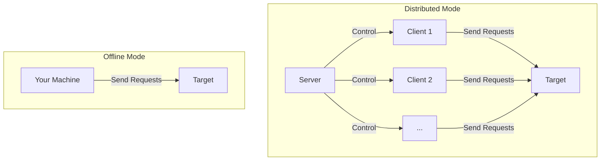

Distributed-Requester
==========
Distributed stress testing tool for web servers  
分布式网络服务器压力测试工具

## Introduction

This tool is designed for distributed stress testing of web servers. It supports both offline mode with predefined tasks and distributed mode where clients will fetch tasks from server in advance.



## Get Started

### Installation

1. Python >=3.9 is required.
2. Use [Poetry](https://python-poetry.org) (recommended) or pip to install dependencies.

### Usage

To use the tool in command line:

```txt
usage: main.py [-h] [-s] [-c] [config_file]

positional arguments:
  config_file   Configuration file path (default: config.json)

options:
  -h, --help    show this help message and exit
  -s, --server  Run in server mode
  -c, --client  Run in client mode
```

If no argument is provided, it will run in `--client` mode with `config.json` by default.

If config file is provided but no option is provided, it will run in offline mode.

## Configuration

The config file is a JSON file that looks like this:

```jsonc
{
  "version": "0.6", // required
  "tasks": [
    // ...
  ],
  "server": {
    // ...
  },
  "client": {
    // ...
  }
}
```

Here are the details of each section:

### `tasks`

The `tasks` list contains some task objects whose schema is as follows:

```jsonc
{
  "name": "Example Task", // required
  "requests": [ // required, must not be empty
    {
      "url": "https://httpbin.org/get", // required
      "method": "GET", // optional, default to "GET"
      "headers": { // optional
        "Content-Type": "application/json",
        "User-Agent": "httpx/0.28.0"
      }
    },
    // another request
    {
      "url": "https://httpbin.org/post",
      "method": "POST",
      "data": "key1=data1&key2=data2" // can also be object
    },
    // multipart/form-data upload request
    {
      "url": "https://httpbin.org/post",
      "method": "POST",
      "data": { // optional, sent as form fields when files is not empty
        "description": "upload test"
      },
      "files": [ // optional, enables multipart/form-data when not empty
        {
          "name": "document", // required, multipart field name
          "path": "./assets/report.pdf", // required, local file path on the client
          "filename": "report.pdf", // optional, defaults to basename of path
          "content_type": "application/pdf", // optional, guessed from path if omitted
          "cache": false // optional, default to false, if true, caches file bytes in memory before requests start
        }
      ]
    }
  ],
  "rules": [ // optional
    {
      "event": "onConsecutiveStatus", // required, currently only "onConsecutiveStatus" is supported
      "action": "stopCurrentTask", // required, can be "switchToNextProxy", "switchToPrevProxy", "switchToRandomProxy", "stopCurrentTask", "stopProgram"
      // the following fields are required if event is "onConsecutiveStatus"
      "status": [ // required, see ResponseStatus enum class for details
        "Connect Timeout"
      ], 
      "count": 20 // required, the number of consecutive occurrences
    }
  ],
  "policy": { // optional (children are also optional)
    "skip_ssl_verification": false, // default to false, if true, skips TLS certificate verification
    "reuse_connections": true, // default to true
    "order": "random", // default to "random", currently only "random" is supported
    "schedule": { // schedule time values can be seconds or ISO time string like "2025-01-01T00:00+08:00"
      "start": 0, // omitted/null/0 means start immediately
      "end": 30 // omitted/null/0 means no end
    },
    "limits": {
      "rps": 5, // omitted/null means no limit
      "rpm": 250, // omitted/null means no limit
      "coroutines": 16 // omitted/null default to 64
    },
    "timeouts": {
      "connect": 5.0, // default to 5.0
      "read": 10.0, // default to 10.0
      "write": 10.0 // default to 10.0
    },
    "proxy": {
      "order": "switchByRule", // default to "random", can be "random", "sequential", "switchByRule"
      "preflight": false, // default to false, if true, will preflight the proxy before using it, only available in "switchByRule" mode
      "preflight_url": "https://httpbin.org/get", // required if preflight is true
      "preflight_timeout": 5.0, // default to 5.0
      "preflight_max_switches": 3, // default to 3, the maximum number of times to switch proxies during preflight
    }
  },
  "prefabs": { // optional (children are also optional)
    "override_hosts": { // overrides the system DNS resolver
      "example.com": "1.2.3.4",
      "www.example.com": "1.2.3.4"
    },
    "default_headers": { // default headers for all requests in this task
      "Accept-Encoding": "gzip, deflate, br, zstd",
      "Accept-Language": "en"
    }
  },
  "proxies": [ // optional, the proxy pool
    "sock5://1.2.3.4:1080", // a single proxy URL
    "http://1.2.3.4:1080",
    null // null means a direct connection (no proxy)
  ]
}
```

When `files` is not empty, the request is sent as `multipart/form-data`. The optional `data` object is sent as regular form fields. Do not manually set `Content-Type: multipart/form-data`; the client removes it for upload requests so httpx can generate a valid boundary. Upload file paths are resolved on the client machine. The client checks all declared upload files before workers start; if any file is missing, the task fails without sending requests. If `cache` is true, the file bytes are loaded into memory before requests start and reused by the file pool.

### `server`

The `server` section defines the server (controller machine) configuration. It's required only if running in server mode.

Schema of the server object:

```jsonc
{
  "port": 5000, // required, the port the server will listen on
  "distributing": { // required
    "task_order": "random" // required, currently only "random" is supported
  }
}
```

### `client`

The `client` section defines the client (worker machine) configuration. It's required only if running in client mode.

Schema of the client object:

```jsonc
{
  "server_url": "http://127.0.0.1:5000", // required
  "report": { // optional
    "live_report_interval": 30 // optional, default to 30, omitted/null/0 means no reporting
  }
}
```

## Development

### Build

To build an executable file as easy as possible:

Install [Poetry](https://python-poetry.org) (a package manager), then:

```bash
poetry env use python
poetry install
poetry run python Build.py
```

This will generate an executable in the `build/dist` directory.

> Note: Change the word "python" to the actual python interpreter you installed (like "python3" or "python3.12") if necessary.

The `config.json` file in the project directory will also be packaged into the executable, so users can directly run the single executable (with this builtin default config).
If you doesn't want to package such default config into the executable, you should comment the `add-data` line in the `pyproject.toml` file.

## Licensing

This project is licensed under the MIT License. See the [License](https://github.com/isHarryh/Distributed-Requester/blob/main/LICENSE) file for more details.
